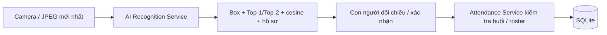

# Prompt 2 — Điểm danh theo lớp và đồng bộ frontend

Đã bổ sung vào dự án `F:\FACE_RECOGNITION`, không xây dựng lại. Website chỉ phục vụ **http://127.0.0.1:5055**, không có đăng nhập và không triển khai Internet.

## 1. Tổng quan

Giữ hệ thống quản lý lớp/sinh viên, đăng ký khuôn mặt, ánh xạ, năm hồ sơ và 92 embedding đã có. Đã đọc bốn báo cáo giai đoạn trước và đối chiếu mã nguồn/schema: database ban đầu có sáu bảng quản lý; attendance service/template cũ mới là placeholder.

Đã bổ sung:

- Chọn lớp, tải danh sách và tạo buổi điểm danh.
- Snapshot danh sách tại lúc bắt đầu, trạng thái chưa ghi nhận độc lập với Vắng mặt.
- Tái sử dụng camera hai luồng, nhận diện trong phạm vi danh sách buổi.
- Xác nhận từng ứng viên hoặc sinh viên từ danh sách bằng thao tác con người.
- Chống ghi trùng, kết thúc buổi bằng transaction, tự hoàn tất Vắng mặt cho phần chưa ghi nhận.
- Lịch sử theo lớp/ngày, xem chi tiết, tiếp tục buổi đang mở, sửa kết quả có lý do và nhật ký.
- Báo cáo chuyên cần theo lớp/sinh viên, chỉ tính buổi đã kết thúc; xuất CSV UTF-8.
- Một sidebar/header và hệ thống màu navy–xanh dương–trắng trên sáu màn hình chính, cùng camera kiểm thử thứ bảy.

Không đổi weights, detector/preprocessing/normalization đã chọn cho camera, không trích xuất lại 92 ảnh, không tối ưu sâu tốc độ, không đặt ngưỡng và không tự ghi Có mặt từ top-1.

## 2. Database và bảo vệ lịch sử

Tiếp tục `outputs/management.sqlite3`; migration dùng `CREATE TABLE/INDEX IF NOT EXISTS`, không drop/reset/seed. Có bản sao trước migration tại `outputs/phase2/before.sqlite3` (dữ liệu nhạy cảm, không công khai).

| Bảng mới | Nội dung |
|---|---|
| `attendance_sessions` | id, class_id FK, mã/tên lớp snapshot, ngày, tên buổi, status, started_at, ended_at, created_at, request_key UNIQUE |
| `attendance_records` | id, session_id FK, student_id FK, mã/họ tên snapshot, attendance_status, recognition_source, confirmed_at, updated_at, UNIQUE(session_id,student_id) |
| `attendance_edits` | record_id FK, old_status, new_status, reason, created_at |

Quy tắc:

- Session chỉ `IN_PROGRESS` hoặc `COMPLETED`. Chỉ một buổi đang mở cho mỗi lớp, bằng partial unique index.
- Lớp rỗng hoặc chưa chọn lớp không được bắt đầu. `request_key` từ UUID trình duyệt giúp retry tạo buổi không sinh bản sao; cùng key/nội dung khác bị từ chối.
- Tạo buổi trong `BEGIN IMMEDIATE`: chụp tên lớp và danh sách sinh viên đang hoạt động, tạo đúng một record mỗi người. Ban đầu `attendance_status=NULL`, nghĩa là **Chưa ghi nhận**, chưa phải Vắng mặt.
- Xác nhận chỉ cập nhật record trong snapshot của buổi đang mở; cần `confirmed=true`. Ghi `PRESENT`, `recognition_source=MANUAL`, timestamp UTC. Xác nhận lại trả `changed=false`, không tạo dòng hoặc đổi timestamp lần đầu.
- `AI_VERIFIED` chỉ là enum dự phòng, không có đường API hiện tại nào gán nguồn đó. Xác nhận ứng viên AI vẫn là con người xác nhận MANUAL.
- Kết thúc khóa transaction: dòng NULL thành `ABSENT`/MANUAL do thao tác kết thúc của người vận hành, rồi ghi COMPLETED/ended_at. Xác nhận đến sau kết thúc nhận HTTP 409. Kết thúc lại không sửa timestamp/kết quả.
- Sửa lịch sử chỉ được thực hiện khi COMPLETED, cần trạng thái hợp lệ, xác nhận và lý do. Lưu nhật ký trước/sau, luôn MANUAL, không ảnh hưởng buổi khác.
- FK dùng RESTRICT, không cascade xóa lịch sử. Quản lý cũ dùng soft delete; snapshot vẫn giữ tên/mã/sinh viên cũ kể cả đổi tên, phân lớp lại hoặc lưu trữ hồ sơ/lớp.
- Truy vấn chi tiết và báo cáo nhiều bước dùng transaction đọc để thống kê nhất quán. Báo cáo bỏ toàn bộ buổi IN_PROGRESS; mẫu số là số lượt snapshot của buổi hoàn tất, không phải danh sách lớp hiện tại.

## 3. API mới và kiểm tra

Mọi API ghi dùng token trang và kiểm tra cùng origin như hệ thống cũ. Đây là bảo vệ yêu cầu trên localhost, **không phải đăng nhập/phân quyền**.

| Phương thức | URL | Mục đích |
|---|---|---|
| GET | `/api/attendance/sessions?class_id=&date=` | Lịch sử/lọc lớp và ngày |
| POST | `/api/attendance/sessions` | Tạo buổi: class_id, session_name, session_date, request_key |
| GET | `/api/attendance/sessions/<id>` | Snapshot, record, thống kê và nhật ký |
| POST | `/api/attendance/sessions/<id>/confirm` | student_id, confirmed=true, recognition_source=MANUAL |
| POST | `/api/attendance/sessions/<id>/finish` | Kết thúc buổi |
| PUT | `/api/attendance/sessions/<id>/records/<student_id>` | Sửa lịch sử: attendance_status, confirmed=true, reason |
| GET | `/api/attendance/reports?class_id=` | Thống kê buổi hoàn tất, theo lớp/sinh viên |
| GET | `/api/attendance/reports.csv?class_id=` | CSV có BOM tiếng Việt, chống formula injection |

Các route quản lý và AI cũ giữ nguyên. POST `/api/camera/sessions` nhận thêm `attendance_session_id` tùy chọn; camera kiểm thử không cần tham số này. API kiểm tra buổi còn mở lúc tạo camera, trước xử lý và sau suy luận; frame đến muộn sau khi kết thúc trả 409. AI không gọi service xác nhận.

Kiểm tra API bằng bộ test:

```powershell
& .\.venv\Scripts\python.exe tests/phase2_unit_runner.py
```

## 4. AI, camera và tích hợp theo lớp

Kiến trúc:



Giữ camera hai luồng và profile `retinaface_scaled_experimental` đã có: YuNet chỉ vị trí ẩn danh, RetinaFace/ArcFace nhận diện; không thay preprocessing/weights/tốc độ gửi trong lượt này. Video tiếp tục, một identity request, không hàng đợi; tên nằm trên ảnh đối chiếu đã gửi, không gán tên chậm lên người mới trên video.

Thay đổi cần thiết để tích hợp:

- Buổi camera được bind với attendance_session_id phía backend. Danh sách được phép lấy từ snapshot SQLite, không tin danh sách ID do frontend gửi.
- So khớp cosine trong gallery của các student ID thuộc buổi. Giữ max sample/người và top-1/top-2 khác người; lớp chỉ có một người có dữ liệu mặt trả top-2/margin trống, không bịa đối thủ. Không có vector hợp lệ trong lớp thì trả Không xác định và không bật xác nhận từ AI.
- Kiểm tra thêm ứng viên gần nhất toàn gallery. Nếu ứng viên đó không thuộc buổi, đánh dấu `outside_class`, không cho xác nhận trực tiếp từ đề xuất AI; vẫn cho người vận hành chọn thủ công trong roster sau đối chiếu. Đây là cảnh báo ứng viên gallery ngoài lớp, không phải khẳng định danh tính thật của khuôn mặt.
- Ngưỡng chưa được kiểm chứng: mọi ứng viên vẫn chưa xác nhận. Người lạ có thể giống một mẫu trong lớp; không khẳng định khả năng từ chối người lạ khi thiếu dữ liệu có nhãn.
- Frontend chỉ tạo nút xác nhận khi response đúng buổi đang hiển thị, hồ sơ thuộc snapshot và eligible. Backend vẫn kiểm tra lại session/student/source/confirmation, không dựa vào JavaScript.
- Đổi lớp/tắt camera/kết thúc buổi hủy request hoặc bỏ response muộn. Đổi lớp giữ buổi cũ trong lịch sử để tiếp tục. Tắt camera không kết thúc hoặc làm mất buổi. Reload/restart dùng `/attendance?session=<id>` hoặc liên kết Tiếp tục từ lịch sử.
- Bổ sung phản hồi RESOURCE_LIMIT/503 khi bắt được lỗi cấp phát bộ nhớ trong AI; không tạo dữ liệu điểm danh từ frame lỗi. Không thay thuật toán để xử lý lỗi RAM.

Service điểm danh không phụ thuộc ArcFace, RetinaFace hoặc similarity. Sau này có thể thay AI Recognition Service nhưng giữ API xác nhận/session/history/reports và SQLite.

## 5. Frontend đồng bộ

Màu khai báo tập trung ở **`frontend/static/css/design-system.css`**:

| Token | Màu |
|---|---|
| Navy | `#142D4E` |
| Primary | `#2176AE` |
| Nền | `#F3F7FB` |
| Card | `#FFFFFF` |
| Chữ | `#1F2937` |
| Chữ phụ | `#64748B` |
| Viền | `#E2E8F0` |

Xanh lá chỉ dùng trạng thái thành công/Có mặt/đăng ký hợp lệ; cam cho chờ; đỏ cho lỗi/Vắng mặt. Không dùng teal/turquoise hoặc `#12A89D`. Hai CSS layout cũ được giữ nhưng màu chuyển sang variables dùng chung, không còn bảng màu hex riêng; canvas đọc màu từ tokens. Không tải webfont hoặc hiệu ứng nặng; thống nhất Segoe UI/system sans-serif hỗ trợ tiếng Việt.

Header/sidebar Jinja dùng chung `_header.html`, `_sidebar.html`. Sáu mục điều hướng hoạt động: Tổng quan, Lớp, Sinh viên, Điểm danh AI, Lịch sử, Báo cáo; thêm link camera kiểm thử riêng. Không có menu giả/Đăng nhập/Đăng xuất.

Các trang:

- `/overview`: số lớp, sinh viên và hồ sơ có mặt đăng ký lấy từ SQLite.
- `/classes`, `/classes/<id>`: giữ CRUD, tìm kiếm và phân lớp.
- `/students`, `/students/<id>`: giữ CRUD, mã tạm, đăng ký và ánh xạ.
- `/attendance`: form chọn lớp/tên/ngày; tạo/tiếp tục/tạo buổi mới; camera lớn trái, thống kê–ứng viên–roster phải; xác nhận từng người và kết thúc.
- `/history`, `/history/<id>`: bộ lọc, snapshot, sửa kết quả và nhật ký; có thể lọc lớp đã lưu trữ nhờ snapshot.
- `/reports`: thống kê thực, tỷ lệ chuyên cần và CSV; trạng thái rỗng nếu chưa có buổi hoàn tất.
- `/`: camera kiểm thử đã có, cùng sidebar/header/navy/blue và chức năng AI.

Button, bảng, input/select, dialog, card, khoảng cách, trạng thái disabled/loading và thông báo thống nhất. Màn hình hẹp xếp camera và các card theo chiều dọc; không tràn ngang 390 px. Controls camera được đặt trước video để dễ thao tác khi trang có form buổi học.

## 6. Kiểm thử thực tế

### Unit/API: 47/47 đạt

`outputs/phase2/unit_tests.json`: 47 tests, 0 failures, 0 errors, 0 skipped. Bao gồm 12 ca điểm danh mới và 35 ca quản lý/import/camera/preview (có thêm ca RESOURCE_LIMIT).

Bao phủ tạo buổi/snapshot/idempotency, chưa chọn lớp/lớp rỗng, người ngoài roster, xác nhận thủ công, từ chối AI_VERIFIED, chống trùng, hai xác nhận đồng thời, xác nhận đua với kết thúc, auto-absent, hoàn tất lại, chặn ghi sau đóng, sửa có audit và tách buổi, không đổi lịch sử khi đổi tên/phân lớp/soft-delete, báo cáo chỉ COMPLETED, CSV, bộ lọc sai, mở lại Flask trong tiến trình Python mới, scope gallery 0/1/nhiều người và response muộn sau đóng. Các ca cũ cho đăng ký, mapping, import và API camera vẫn đạt.

Có ResourceWarning từ multipart tạm trong harness và log ERROR ở ca chủ động giả lập lỗi AI/MemoryError; không phải lỗi ghi dữ liệu thật. Lượt kiểm thử ban đầu từng thiếu RAM khi chạy cùng tiến trình TensorFlow; đã dừng tiến trình đó và chạy tuần tự. Số đếm cuối ở JSON, không cộng các lượt chạy lặp.

### Giao diện: 15 kiểm tra mới + 12 hồi quy camera đạt

`tests/phase2_browser_qa.py` dùng Chrome, Flask/API và SQLite thật trong **database tạm**; AI/media được giả lập để chủ động tình huống. Đã thực hiện:

1. Tạo lớp qua UI, thêm đủ năm hồ sơ.
2. Chọn lớp, tạo snapshot và thống kê.
3. Hai khuôn mặt có hai ứng viên/nút riêng.
4. AI trả ứng viên không tự ghi Có mặt.
5. Con người xác nhận một sinh viên, lưu MANUAL.
6. Giả lập tín hiệu camera ngắt, không mất hoặc kết thúc buổi; bật lại được.
7. Kết thúc: 1 Có mặt, 4 Vắng mặt.
8. Xem lịch sử, sửa thêm một Có mặt có lý do.
9. Báo cáo đúng 40% (2/5) trên dữ liệu tạm đó.
10. Tạo buổi tiếp theo, báo cáo bỏ buổi chưa kết thúc.
11. Đổi lớp/trống xóa context camera, giữ buổi cũ để tiếp tục.
12. Mở lại Flask/SQLite không mất kết quả.
13. Bảy trang cùng sidebar/header và màu tokens đúng.
14. Responsive 390 px không tràn trang.
15. Không lỗi JavaScript.

`tests/realtime_camera_browser_qa.py` được chạy ở chế độ offline với SQLite tạm, trả report mới riêng: 12 kiểm tra hồi quy camera đạt (video tiếp tục, tối đa một identity job, khung trước tên, nhiều mặt/trống, clear, late response, lỗi, timeout/backoff, quyền camera, geometry và mobile). Không ghi đè report camera cũ. Kết quả: `browser_tests.json`, `camera_browser_tests.json`.

### AI thật và toàn bộ luồng điểm danh

`real_ai_tests.json`: đăng ký ảnh thực tạo vector, từ chối không mặt/nhiều mặt, mapping, persistence, gallery mới và API cũ đều đạt; cosine embedding đăng ký so với pipeline gốc **0,9999999999999999**, model_load_count=1. Thao tác đăng ký thực khoảng 31,85 s ở lượt này; không coi đó là cam kết tốc độ.

`real_attendance_e2e.json`: sử dụng ArcFace/RetinaFace thật, ảnh registered và database tạm với hai hồ sơ trong buổi. API trả ứng viên đúng profile đã ánh xạ, **chưa có ai PRESENT trước xác nhận**. Sau xác nhận thủ công có 1 PRESENT; xác nhận lại không trùng; kết thúc còn 1 ABSENT; báo cáo 50%; camera frame đến sau kết thúc trả **409**. Lượt suy luận qua Flask test client khoảng **9,67 s**, không phải 1–2 s hay phép đo mạng/camera người thật.

Không chạy lại validation 25 ảnh hoặc benchmark tối ưu: thuật toán/weights/preprocessing không đổi. Chỉ kiểm tra tích hợp/scoring theo lớp và hồi quy cần thiết. Không kế thừa số 25/25 cũ thành bằng chứng nhận diện người lạ.

### Webcam vật lý và giới hạn

Lần thử đầu mở được camera 640×480 nhưng chưa xong frame; OpenCV/Werkzeug báo thiếu RAM (cấp phát khoảng 3,7 MB/10 MB không thành công). Harness lúc đầu cũng chưa xử lý ký hiệu “—” của số mặt khi lỗi; đã sửa để ghi nhận lỗi đúng.

Thử lại với Chrome kiểm thử giảm tiến trình/GPU: **mở camera, hoàn tất một frame, phát hiện 0 mặt, tắt tracks và xóa kết quả đạt**, thời gian HTTP hiển thị khoảng **16,7 s**. Không lưu ảnh. Đây chỉ là smoke phần cứng; chưa bố trí một/hai/nhiều người thật để xác minh danh tính hoặc thử rút camera vật lý. Báo cáo `physical_camera_initial.json`, `physical_camera.json` giữ cả giới hạn/lượt thử.

**Chưa hoàn thành việc chứng minh demo webcam ổn định trên laptop thiếu RAM hoặc nhận diện 1–2 s.** Lượt trước có thể cấp phát lỗi; lượt sau đạt không chứng minh ổn định mọi thời điểm. Không tự đóng ứng dụng của người dùng, đổi model hoặc hạ ngưỡng để che vấn đề. Luồng xác nhận thủ công vẫn dùng được khi AI lỗi.

### Bảo toàn dữ liệu thật

`final_verification.json`: 222 tệp DATASET/output đã có không đổi SHA-256; mọi hàng trong sáu bảng SQLite cũ khớp snapshot trước migration; integrity/khóa ngoại đạt. Năm sinh viên và 92 vector/liên kết còn đủ. Ba bảng điểm danh mới trong **database thật đều rỗng**, không có lớp/buổi/record điểm danh giả. Bảy trang HTTP 200; thiếu token ghi bị 403, dữ liệu ảnh/vector/SQLite không có route public.

## 7. File tạo/sửa và cách chạy

Tạo mới:

- `backend/attendance/routes.py`
- `frontend/templates/_sidebar.html`, `_header.html`, `_attendance_controls.html`, `attendance_pages.html`
- `frontend/static/css/design-system.css`, `frontend/static/js/attendance.js`
- `tests/test_attendance.py`, `phase2_browser_qa.py`, `phase2_real_e2e.py`, `phase2_verify.py`, `phase2_unit_runner.py`
- `PHASE_2_REPORT.md`, các kết quả và backup trong `outputs/phase2/`.

Sửa:

- `backend/attendance/attendance_service.py`: từ placeholder thành service nghiệp vụ.
- `backend/app.py`: khởi tạo/mount service/API, bind scope camera, kiểm tra frame muộn, thông báo lỗi RAM.
- `backend/face_recognition/face_service.py`, `runtime_service.py`: so khớp tập con theo ID và cảnh báo global candidate ngoài lớp; không đổi neural pipeline.
- `frontend/templates/index.html`, `management.html`: shared shell và nhúng controls điểm danh vào camera cũ.
- `frontend/static/css/style.css`, `management.css`: giữ layout, chuyển màu sang tokens.
- `frontend/static/js/camera.js`: bridge buổi, formatter thiếu top-2, event ứng viên, màu canvas và thông báo lỗi JSON.
- `frontend/static/js/management.js`: bỏ thông báo giai đoạn cũ, giữ nghiệp vụ.
- `tests/phase1_real_ai.py`, `realtime_camera_browser_qa.py`, `camera_physical_smoke.py`, `test_camera_preview.py`: hook/đích report tạm, QA offline, lỗi phần cứng và resource test.

Không cài thêm dependency. `.gitignore` đã loại DATASET, outputs, SQLite, weights, embedding và venv; không public dữ liệu.

Chạy từ workspace:

```powershell
& .\.venv\Scripts\python.exe -m backend.app
```

Chỉ chạy một Flask trên cổng 5055. Mở **http://127.0.0.1:5055/overview** hoặc **http://127.0.0.1:5055/attendance**. Ctrl+F5 sau restart để lấy token/JS/CSS mới. Đợi model nếu cần camera; không cần đăng nhập. Có thể kiểm tra SQLite bằng Python sqlite3 hoặc công cụ SQLite ở VS Code, không xóa file khi khởi động.

## 8. Hướng dẫn demo

**Tạo lớp → Thêm sinh viên → Chọn lớp → Bắt đầu điểm danh → Bật camera → Nhận diện → Xác nhận Có mặt → Kết thúc → Xem lịch sử → Xem báo cáo.**

1. Trong Quản lý lớp, mở lớp thật hiện có hoặc tạo lớp theo thông tin người dùng; thêm năm sinh viên đã có bằng chức năng phân lớp. Không cần đăng ký lại 92 ảnh.
2. Vào Điểm danh AI, chọn lớp, nhập tên/ngày buổi rồi Bắt đầu. Lớp rỗng sẽ được hướng dẫn phân lớp trước.
3. Bật camera, đợi ảnh đối chiếu/ứng viên, kiểm tra đúng người rồi bấm Xác nhận Có mặt; hộp xác nhận nhắc đây là thao tác thủ công. Có thể xác nhận trực tiếp từng sinh viên trong roster khi camera chậm/lỗi hoặc chưa có mặt đăng ký.
4. Kết thúc và xác nhận thông báo auto-absent cho phần còn lại. Không dùng số mặt làm số người Có mặt.
5. Mở Lịch sử để xem snapshot/kết quả; nếu cần sửa thì chọn trạng thái và nhập lý do. Báo cáo chỉ tính buổi hoàn tất, có lọc lớp và xuất CSV.
6. Tạo buổi mới từ nút tương ứng. Buổi đang mở có thể tiếp tục qua lịch sử sau refresh/restart; camera phải bật lại, dữ liệu đã xác nhận không mất.

## 9. Còn lại và phạm vi xác nhận

Đã hoàn thành phần nghiệp vụ điểm danh, lịch sử, sửa kết quả, báo cáo, đồng bộ thiết kế, hồi quy và tích hợp AI qua ảnh thật. Không có lỗi chức năng tự động còn thất bại trong bộ cuối (47 unit/API, 27 kiểm tra UI, luồng real AI đạt).

Chưa hoàn thành/kiểm thử: xác minh danh tính của người thật đứng trước webcam trong các tình huống một/nhiều/người lạ, đánh giá false accept/reject với người lạ có nhãn, ổn định webcam khi máy cạn RAM, và cam kết tốc độ 1–2 s. Cần kiểm tra demo thực tế với người vận hành và tài nguyên máy phù hợp; không suy đoán kết quả từ validation hoặc giả lập UI.

Chưa có đăng nhập/phân quyền theo yêu cầu, vì vậy chỉ sử dụng localhost/mạng nội bộ được kiểm soát. Các cải tiến AI/liveness/tracking/độ trễ tương lai nằm sau ranh giới AI Recognition Service và cần đánh giá lại; không bắt buộc viết lại service điểm danh hoặc lịch sử.
