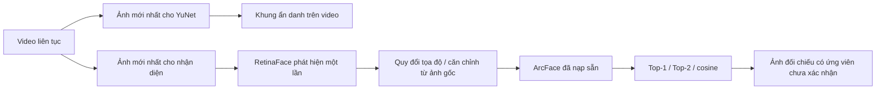

# Camera hai luồng và giao diện phân tích AI

Đã sửa trực tiếp dự án tại `F:\FACE_RECOGNITION`. Website dùng Flask hiện có, cổng **5055**, chỉ localhost. Hoàn thành phần triển khai và kiểm thử chức năng; **chưa đạt mục tiêu nhận diện danh tính ổn định trong 1–2 giây**. Không ghi điểm danh hoặc xác nhận danh tính tự động.

## 1. Rà soát và nguyên nhân chờ khoảng 22 giây

Đã đọc `CAMERA_OPTIMIZATION.md`, `PHASE_1_REPORT.md`, `STUDENT_DATA_IMPORT_REPORT.md`, app/API, camera JavaScript, dịch vụ/model/profile, gallery và kiểm thử. Không tìm thấy ảnh tham khảo thiết kế ngoài dữ liệu khuôn mặt; giao diện thực hiện theo bố cục mô tả trong yêu cầu.

Trước sửa, **giao diện chọn `retinaface_reuse`**, không chọn RetinaFace không phóng ảnh. API không truyền profile cũng dùng cấu hình cũ này. Camera gửi JPEG tối đa 640×480, mỗi lúc một request. Mô hình, ma trận gallery được giữ trong bộ nhớ; không có bằng chứng nạp lại từng request. SQLite chỉ kiểm tra revision để cập nhật gallery khi thay đổi.

Đã tái hiện bằng HTTP trên server đang chạy, cùng một ảnh một người, ba lượt:

| Lượt | HTTP | RetinaFace | Embedding |
|---|---:|---:|---:|
| Đầu tiên trong phép đo | 37,64 s | 32,13 s | 4,38 s |
| Kế tiếp | 22,29 s | 17,73 s | 3,58 s |
| Kế tiếp | 24,22 s | 20,10 s | 3,10 s |

Đây là lượt đầu **của phép đo**, server cũ đã chạy trước đó; không gọi đó là cold start của tiến trình. RetinaFace thêm biên/căn chỉnh trên ảnh lớn và phóng ảnh nội bộ là phần tốn thời gian chủ yếu. So khớp 92 vector và HTTP không giải thích được phần lớn 22 giây. Frontend trước đây đợi hết phát hiện + ArcFace mới vẽ khung, nên khung và tên đều đến muộn.

Máy có **3,842 GiB RAM**. Tại phép đo trước sửa: dùng **99%**, còn khoảng **28 MiB**; các phép đo sau vẫn dùng khoảng **95–98%**. Công cụ kiểm tra ban đầu từng gặp `MemoryError` khi đọc toàn bộ một file weights để hash; đã đổi sang hash từng block 1 MiB. Chrome kiểm thử cũng từng bị đóng khi chạy đồng thời benchmark nặng, nên các lượt QA trình duyệt sau được chạy riêng và hạn chế tiến trình/extension.

RAM gần đầy là dữ kiện đo được; **chưa đo riêng hard page faults, lưu lượng swap hoặc CPU utilization**, nên không kết luận mọi độ trễ đều do swap. Không loại bỏ các mẫu chậm để làm đẹp kết quả.

## 2. Pipeline sau sửa



### Phát hiện vị trí

- Thêm POST `/api/detect`, dùng cùng token, session, xác thực JPEG, giới hạn request và `Server-Timing`.
- YuNet đã có sẵn được giữ trong bộ nhớ, chỉ trả tọa độ/confidence phát hiện, **không có tên, embedding hoặc quyết định danh tính**.
- Khóa preview riêng, không phải chờ khóa ArcFace; OpenCV YuNet được bảo vệ vì cấu hình input/score của đối tượng là mutable.
- Mỗi client chỉ một request preview đang chạy, không xếp hàng. Chu kỳ mục tiêu khoảng 400 ms khi rảnh, khoảng 1.000 ms khi ArcFace đang chạy để hạn chế tranh CPU. Khi lỗi có backoff.
- Vị trí quá cũ hết hạn khoảng 1.200 ms, không giữ khung vô thời hạn. Overlay cập nhật tối đa 10 Hz; video vẫn do trình duyệt phát liên tục.

### Nhận diện danh tính

- Mặc định giao diện mới: `retinaface_scaled_experimental`, ghi rõ thử nghiệm. **Chỉ đầu vào detector** giảm cạnh dài xuống 480 px, không phóng lớn. Bounding box/landmarks được quy đổi về ảnh gửi gốc tối đa 640×480, rồi căn chỉnh/cắt trên ảnh gốc để ArcFace xử lý.
- Giữ lựa chọn RetinaFace không phóng ảnh ở toàn kích thước và RetinaFace tương thích cũ. API cũ không truyền profile vẫn dùng `retinaface_reuse` để bảo toàn hợp đồng; frontend mới luôn gửi profile rõ ràng.
- Không đổi trọng số ArcFace/RetinaFace, normalization `base` hay cấu hình đăng ký. Biến thể phát hiện được khai báo riêng, không sửa `face_config.json` hoặc ngưỡng.
- Một khóa toàn tiến trình cho suy luận ArcFace/đăng ký; request bận trả 429, không xếp hàng nhiều inference. Một request nhận diện mỗi client; gửi ảnh mới sau khi lượt trước kết thúc, không lưu frame để chờ.
- Preview có khuôn mặt thì tự nhận diện; khi preview không tìm thấy mặt, có lượt kiểm tra RetinaFace định kỳ khoảng 8 giây để YuNet không trở thành cổng bỏ sót vô hạn. Không tạo embedding ở mọi frame video hoặc mọi lượt preview.
- Mỗi ảnh nhận diện chỉ gọi RetinaFace một lần; tái sử dụng vùng/landmarks đã phát hiện. Hai luồng có hai mục đích và lấy ảnh mới riêng: không lấy crop YuNet để tự coi là đầu vào ArcFace tương đương bộ đăng ký.
- Không cache danh tính theo vị trí hay track ID chưa được kiểm chứng. Top-1/Top-2 vẫn là hai danh tính khác nhau và dùng cosine trên ma trận 92 vector đã chuẩn hóa.
- Làm nóng ArcFace, RetinaFace ở kích thước detector đang ưu tiên và YuNet bằng ảnh zero trong RAM; thời gian khởi động được báo riêng. Không tạo/lưu embedding đăng ký từ ảnh zero.

## 3. Bảo vệ danh tính và tránh tên cũ

Không có cách bảo đảm một người mới đứng đúng vị trí cũ là cùng người chỉ từ bounding box. Vì vậy **video trực tiếp chỉ vẽ khung ẩn danh**. Tên + similarity được vẽ sát khung trên **ảnh đối chiếu đã gửi** và ở bảng kết quả có ghi rõ tuổi ảnh; không gán tên từ ảnh xử lý chậm lên khuôn mặt mới trên video.

Khi số khuôn mặt thay đổi, khung trống, preview lỗi, bắt đầu nhận diện ảnh mới hoặc tắt camera, xóa ứng viên cũ. Response từ scene/session cũ bị bỏ; kết quả có thời hạn hiển thị khoảng 3,5 giây sau phản hồi. Scene counter là kiểm soát hiển thị, không phải bằng chứng nhận dạng cùng người. Với người đổi nhưng số mặt giữ nguyên, tên vẫn chỉ liên quan ảnh đối chiếu cũ được ghi rõ, không phải video mới.

Top-1 bổ sung metadata SQLite thực (`id`, mã, họ tên, mã tạm) nếu đã ánh xạ. Không suy mã bằng tách chuỗi tên, không gửi vector hoặc đường dẫn ảnh xuống frontend. Mọi kết quả giữ `identity_confirmed=false`, `attendance_enabled=false`. Chưa có dữ liệu người lạ có nhãn để kiểm chứng từ chối; không tự đặt/hạ ngưỡng.

## 4. Giao diện

- Header **AI STUDENT ATTENDANCE**, phụ đề tiếng Việt và trạng thái camera/backend riêng.
- Laptop: camera khoảng 66%, phân tích khoảng 34%; nền sáng, card trắng, video tối, xanh lá hoạt động, cam chưa xác nhận, đỏ lỗi.
- Camera có nút bật/tắt, profile rõ ràng, thời gian xử lý và thông báo. Giới hạn chiều cao video theo viewport để nút điều khiển dễ thấy; `object-fit:contain`, không kéo méo.
- Overlay tính scale và offset letterbox theo kích thước thực của video/canvas, có DPR. Không mirror một phía gây lệch tọa độ.
- Các card trạng thái hệ thống, ứng viên/Top-2/cosine, số sinh viên và embedding đều lấy dữ liệu backend thật. Khi mất kết nối, số liệu gallery được ghi là lần kiểm tra gần nhất.
- Trên màn hình hẹp, camera ở trên và card ở dưới; kiểm tra 390 px không tràn ngang.
- Hết thời gian chờ/lỗi mạng: bỏ kết quả cũ, báo đúng lỗi và thử lại có backoff. Nếu server đã đổi token/session sau restart, yêu cầu tải lại trang; không dùng token cũ để gửi dồn.
- Camera/getUserMedia bị từ chối quyền hoặc ngắt thiết bị có thông báo; tắt camera hủy các request, dừng tracks và bỏ response muộn.
- Giữ đường dẫn quản lý lớp/sinh viên, không xây dựng lại các trang đó hoặc nghiệp vụ điểm danh.

## 5. Benchmark hiện tại

Ba mẫu mỗi tình huống, JPEG 640×480 giữ tỷ lệ/letterbox. P95 từ mẫu nhỏ chỉ mang tính mô tả. Các đợt chạy khác thời điểm và mức sử dụng RAM; không coi mọi chênh lệch là tác động riêng của mã nguồn.

| Profile / tình huống | Trung bình HTTP | P95 HTTP |
|---|---:|---:|
| Trước sửa, RetinaFace reuse, 1 mặt | 28,05 s | 36,30 s |
| RetinaFace không phóng ảnh, 1 mặt | 5,84 s | 7,27 s |
| Detector RetinaFace 480 + crop gốc, 1 mặt | 5,02 s | 5,91 s |
| Detector 480, 2 mặt | 6,25 s | 7,32 s |
| Detector 480, ảnh trống | 2,50 s | 3,74 s |
| Detector 480, 6 mặt | 11,55 s | 12,16 s |

Ảnh hai mặt và sáu mặt đều trả lần lượt 2/6 khung ở ba lượt. Chưa có nhãn bbox/định danh đầy đủ trên ảnh nhóm để tuyên bố recall/accuracy thực của mọi người. RetinaFace full không phóng ảnh ở đợt khác có 2 mặt trung bình 3,85 s và 6 mặt 6,43 s; **không khẳng định detector 480 luôn nhanh hơn**, nhất là dưới áp lực RAM. Có thể chọn lại cấu hình full khi kiểm tra ảnh nhóm; không tự chuyển detector theo danh tính.

Preview trong khi một request ArcFace chạy:

| Đợt | Mẫu preview | Trung bình | P95 | Tệ nhất | Request danh tính đồng thời |
|---|---:|---:|---:|---:|---:|
| Native full, áp lực tài nguyên | 27 | 433 ms | 995 ms | 5.098 ms | 16,20 s |
| Detector 480 | 18 | 149 ms | 282 ms | 430 ms | 6,34 s |

Đây là thời gian HTTP của luồng vị trí, **không phải thời gian xuất hiện tên**. Chưa bảo đảm khung dưới 1 giây trong mọi điều kiện. Không dùng FPS video để tuyên bố tốc độ nhận diện.

Frontend ghi riêng thời gian lấy ảnh/JPEG, HTTP, tổng từ capture đến xử lý phản hồi; `Server-Timing` tách decode, detection, alignment, embedding, matching, serialization, server_total. HTTP trừ server_total chỉ là ước lượng tổng transport/client/parse, không phải phép đo mạng thuần. Diagnostics giới hạn 60 bản ghi, không lưu hình/vector/danh tính.

Lượt API đầu sau startup của đợt native: 7,39 s; detector 480: 5,99 s. Startup đợt native 65,53 s, trong đó warm-up RetinaFace/preview 12,67 s. Kiểm thử model thật sau đó khởi động 95,30 s trong điều kiện khác; model_load_count vẫn 1. Startup không cộng lại ở mọi frame.

## 6. Validation và sai lệch YuNet

- Chạy mới **25 ảnh validation** cho RetinaFace full không phóng ảnh: **25/25 Top-1 đúng**, 25 ảnh đúng một mặt.
- Chạy mới cùng 25 ảnh cho **detector-only resize 480 + crop gốc**: **25/25 Top-1 đúng**, 25 ảnh đúng một mặt. Không kế thừa kết quả cũ.
- YuNet chỉ vẽ vị trí: 25/25 ảnh có một khung trong cả hai lượt. Đây là đếm output trên ảnh đã biết một mặt, không chứng minh mọi điều kiện webcam.
- Điều tra lại hai ảnh từng sai khi dùng YuNet để tạo embedding: `Bùi Kiều Linh_02.jpg`, `Nhi_15.jpg`. RetinaFace trả đúng ứng viên Bùi Kiều Linh/Nhi, còn pipeline YuNet vẫn trả Thu Thảo. IoU bbox giữa hai detector khoảng **0,872** và **0,838**.
- Crop/landmarks đầu vào khác nhau là thay đổi cần đánh giá; phép đo này chưa tách riêng ảnh hưởng của bbox và góc căn chỉnh. Không quy mọi lỗi cho ArcFace và không thay toàn bộ nhận diện sang YuNet vì tốc độ.
- Kiểm thử đăng ký model thật trên database tạm: vector có cosine **0,9999999999999999** với `DeepFace.represent()` gốc cùng ảnh; không thay normalization/căn chỉnh đăng ký.

Không dùng validation/Test thêm vào gallery. Không có người lạ với nhãn thật phù hợp để đánh giá false accept; các số trên chỉ là phân loại đóng trong năm người đã đăng ký.

## 7. Kiểm thử API, giao diện và hồi quy

**34/34 unit/API đạt**:

```powershell
& .\.venv\Scripts\python.exe -m unittest tests.test_management tests.test_student_import tests.test_camera_api tests.test_camera_preview
```

Gồm quản lý lớp/sinh viên, phân lớp, upload/đăng ký với test double, ánh xạ, nhập idempotent, persistence, API camera cũ; bốn ca mới kiểm tra preview ẩn danh, giới hạn/session/decode, 429 và khóa preview độc lập với ArcFace/cancellation. Log lỗi camera giả lập và ResourceWarning multipart của bộ kiểm thử được ghi nhận; các assertion đạt.

**Model thật trên database tạm** cũng đạt: đăng ký ảnh một người (25,31 s), từ chối ảnh trống (26,82 s) và ảnh nhiều người (19,97 s), lưu/mở lại vector bền vững, ánh xạ đúng, API camera thấy gallery mới mà không xác nhận danh tính, model chỉ nạp một lần. Sau đó chuyển lại SQLite thật trước khi phục vụ website; không tạo hồ sơ thử trong database thật.

Giao diện kiểm thử bằng media/AI giả lập để kiểm soát tình huống: khung trước khi có tên, video chạy khi ArcFace bị giữ, tối đa một identity request, nhiều mặt/trống, hết hạn/clear, late response sau tắt, backend lỗi, timeout/backoff, từ chối camera, DPR/letterbox và responsive. Không dùng các kết quả giả lập này làm số đo accuracy hay tốc độ AI thật.

Phép thử video phát lại dataset + API thật đã đổi được ứng viên Bùi Kiều Linh → khung trống → Hà Vi và dừng tracks. Các đợt native có khung đầu khoảng 1,42–2,19 s từ thao tác bật; tên đầu 16,59–26,55 s, đổi người 15,33–27,17 s. Đây là số đo end-to-end thật qua trình duyệt, không che bằng benchmark HTTP 4–6 s. Phép thử này không phải người thật đứng trước camera; số đo cấu hình cuối ghi riêng ở phần xác minh cuối.

## 8. Bảo toàn dữ liệu và file thay đổi

Không thay đổi SQLite, hồ sơ năm sinh viên, phân lớp, mã/tên, schema hoặc dữ liệu khuôn mặt. Xác minh cuối so sánh **toàn bộ SQL logical dump** với snapshot trước sửa, kiểm tra khóa ngoại và integrity. Tệp DATASET, gallery 92 vector, cấu hình đăng ký/ngưỡng, models và báo cáo cũ được đối chiếu SHA-256 từng block. Chỉ báo cáo mới nằm trong `outputs/realtime_camera_ui/`, đã được Git ignore.

Sửa mã ứng dụng:

- `backend/app.py`: thêm route preview dùng chung decoder/session/guard/timing, giữ API camera cũ.
- `backend/face_recognition/runtime_service.py`: preview lock, warm-up riêng, metadata hồ sơ Top-1 từ store đã có.
- `backend/face_recognition/camera_pipeline.py`: khóa detector YuNet dùng chung, profile detector-only resize và quy đổi tọa độ; nhánh enrollment không đổi.
- `backend/camera_profiles.json`: khai báo profile resize thử nghiệm riêng.
- `frontend/templates/index.html`, `frontend/static/css/style.css`, `frontend/static/js/camera.js`: giao diện và hai luồng camera.
- `tests/phase1_real_ai.py`: cho chọn thư mục report riêng và hash streaming để không ghi đè báo cáo cũ hoặc đọc weights lớn toàn bộ vào RAM.

Thêm: `tests/realtime_camera_benchmark.py`, `test_camera_preview.py`, `realtime_camera_browser_qa.py`, `realtime_camera_replay.py`, `realtime_yunet_diagnostics.py`, `realtime_camera_summary.py`, báo cáo này. Không thêm dependency, đăng nhập hoặc bảng điểm danh.

## 9. Chạy và kiểm tra webcam

```powershell
cd F:\FACE_RECOGNITION
& .\.venv\Scripts\python.exe -m backend.app
```

Chỉ chạy một Flask trên cổng 5055. Mở **http://127.0.0.1:5055/**, Ctrl+F5, đợi mô hình sẵn sàng rồi bấm **Bật camera**, cấp quyền. Video có khung ẩn danh sớm; ArcFace tạo ảnh đối chiếu và danh sách ứng viên khi hoàn tất. Đưa một người rồi nhiều người vào khung, rời khung, đổi người; kiểm tra phần tên luôn thuộc ảnh đối chiếu đã ghi tuổi ảnh. Bấm **Tắt camera** để dừng tracks/cả hai luồng và xóa kết quả.

Nếu lỗi, đọc thông báo và Terminal; chờ backoff khi bận/timeout, tải lại trang sau khi restart Flask. Không tự giảm similarity hay chuyển YuNet thành nhận diện chính để ép nhanh. Profile RetinaFace full và tương thích gốc còn trong danh sách để so sánh.

## 10. Đạt/chưa đạt và Prompt 2

Đã có phát hiện ẩn danh độc lập, không cần nút chụp; video liên tục; một ArcFace job; UI hai cột; Top-1/Top-2/cosine/SQLite metadata thật; expiry/cancellation/error recovery; validation mới; hồi quy quản lý/đăng ký; bảo toàn dữ liệu. **Chưa đạt nhận diện danh tính ổn định 1–2 giây, chưa bảo đảm khung dưới 1 giây trên laptop 4 GB, chưa kiểm thử danh tính/người lạ bằng người thật.**

Prompt 2 có thể tái sử dụng session/API preview + recognize và các component camera/ảnh đối chiếu/card kết quả. Việc chọn lớp, mở/đóng buổi, xác nhận Có mặt, lưu Có mặt/Vắng mặt, lịch sử/báo cáo chưa triển khai. Cần quy trình xác nhận và dữ liệu người lạ có nhãn trước khi cân nhắc ghi điểm danh tự động.

Kết quả máy đọc: `outputs/realtime_camera_ui/{before,after,scaled}.json`, `benchmark.csv`, `summary.json`, `browser_tests.json`, `real_ai_tests.json`, `replay*.json`, `yunet_diagnostics.json` và kiểm tra camera vật lý nếu thực hiện. Các con số này là số đo cục bộ, không phải cam kết hiệu năng triển khai.

## 11. Xác minh cuối trên cấu hình/giao diện bàn giao

- Giao diện cuối chọn rõ `retinaface_scaled_experimental`. **12/12 kiểm tra trình duyệt đạt**, bao gồm vị trí pixel khung sau scale/letterbox, trước khi có tên, video liên tục, không hàng đợi, tối đa một identity job, clear khi trống, lỗi backend, timeout có backoff, từ chối quyền camera, stop/late-response, responsive và không lỗi JavaScript. Media/kết quả AI được mock trong bộ kiểm thử này, không trong ứng dụng.
- Phát lại hai ảnh dataset qua video với **API/AI thật** trên cấu hình cuối: khung vẽ đầu tiên **2,66 s từ thao tác bật**, tên đầu **16,87 s**, đổi từ ảnh Bùi Kiều Linh qua khung trống sang Hà Vi mất **13,22 s** để có tên mới. Bộ đo chờ canvas thực sự có khung, không chỉ đọc bộ đếm. Không đạt mục tiêu khung <1 s hoặc tên 1–2 s. Các giai đoạn capture/JPEG, HTTP, server và observation được lưu trong `replay.json`; không được thay chúng bằng FPS video.
- Camera **vật lý** mở được **640×480**, xử lý **1 frame**, phát hiện **0 mặt** trong khung thử đó; thời gian HTTP hiển thị khoảng **4,5 s**. Tắt camera kết thúc tracks và xóa kết quả. Không lưu ảnh. Đây chỉ là smoke test phần cứng/kết nối, chưa có người thật được bố trí hay nhãn danh tính để kiểm thử nhận diện. Xem `physical_camera.json`.
- **209 file DATASET/output đã có trước lượt này: 0 thay đổi SHA-256.** SQLite có logical dump giống hệt trước sửa, `integrity_check=ok`, khóa ngoại không lỗi. Năm hồ sơ, lớp và 92 vector/liên kết không mất hoặc bị sửa. Xác nhận từ SQLite, API và health, không chỉ thông báo giao diện.
- Có thêm một lần `MemoryError` khi công cụ hash 1 MiB chạy đồng thời Chrome trên máy thiếu bộ nhớ. Xác minh cuối được chạy sau khi đóng Chrome QA, dùng hash 64 KiB và thống kê standard library để giảm RAM, đã đạt. Không che giấu lỗi tài nguyên này hoặc coi streaming là giải pháp đủ để laptop đạt thời gian thực.
- Đã khởi động lại dịch vụ Flask chuẩn tại localhost:5055 sau kiểm thử. Nếu tab cũ có token phiên cũ, Ctrl+F5 rồi bật camera lại. Không triển khai công khai.
- Health tiến trình chuẩn cuối: ready, model_load_count=1, 92 vector / 5 sinh viên; startup **68,82 s**. Trang camera, Tổng quan, Sinh viên và Lớp học đều HTTP 200. Xem `final_health.json`; con số startup khác các đợt trên do chạy ở thời điểm/tình trạng tài nguyên khác nhau.
- Kết quả 25/25 chỉ áp dụng bộ ảnh đã kiểm thử trên canvas JPEG 640×480 giữ tỷ lệ/letterbox. Camera có tỷ lệ khác vẫn được giữ nguyên tỷ lệ khi gửi; không tự coi kết quả đó chứng minh độ đúng cho mọi độ phân giải, ánh sáng hoặc người thật.
